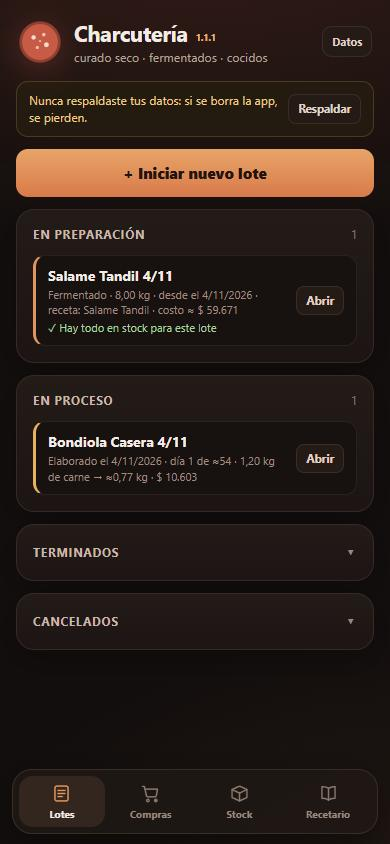
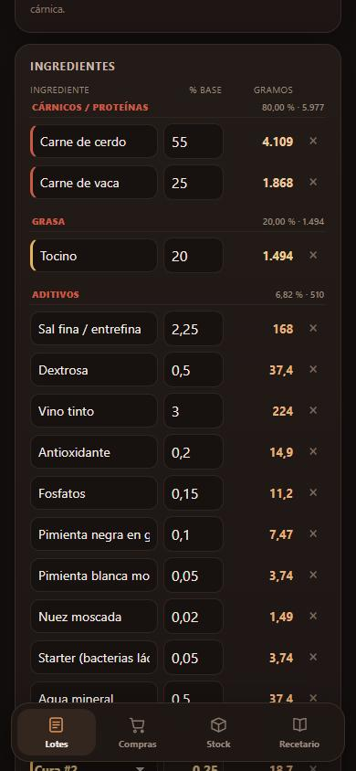
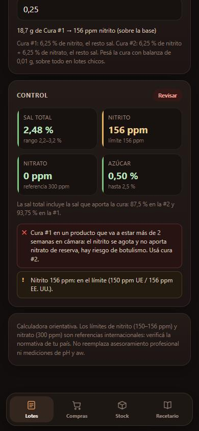
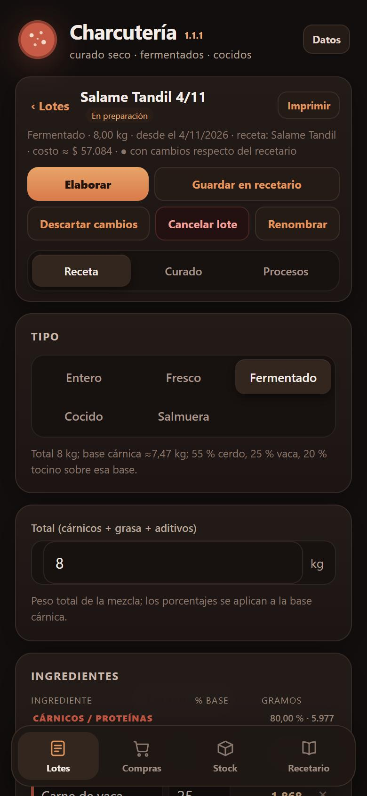
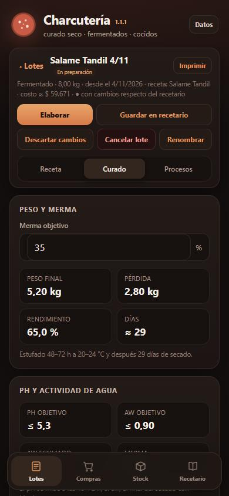
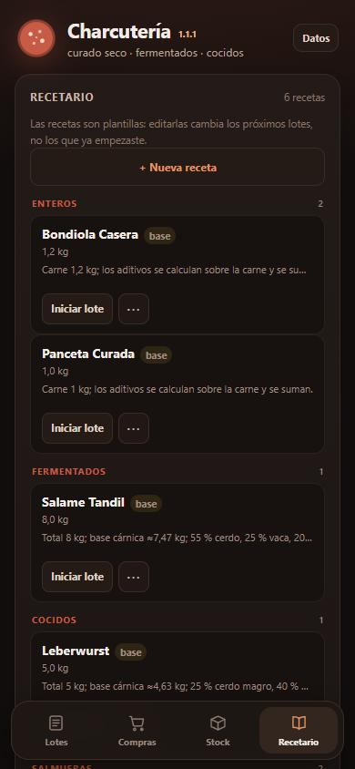
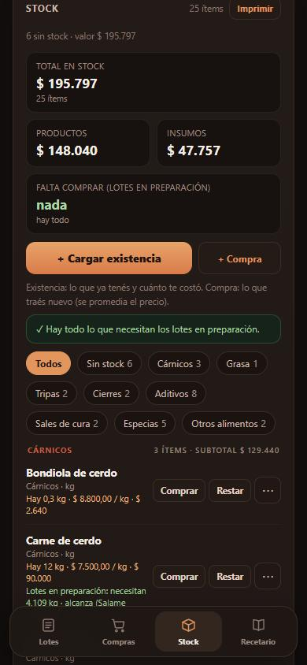
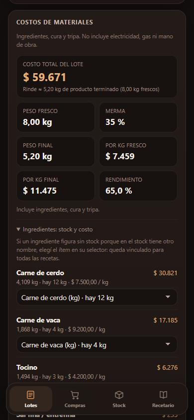
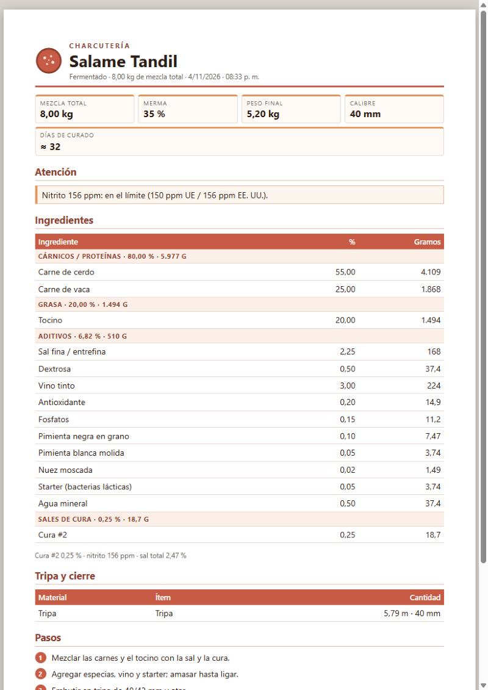

# Charcutería

**Calculadora y cuaderno de charcutería casera para Android y la web.** Gratis, open source y offline.

Pensada para quien hace salames, bondiolas, pancetas, leberwurst o salmueras en su casa: pesás la carne, la app calcula la sal, la sal de cura, los aditivos y las especias, te avisa si algo es peligroso, lleva la cuenta de lo que tenés en el stock y te arma la receta en PDF para tenerla a mano en la mesada.

[](LICENSE)


<table>
  <tr>
    <td align="center"><br><sub>Lotes</sub></td>
    <td align="center"><br><sub>Receta</sub></td>
    <td align="center"><br><sub>Avisos de seguridad</sub></td>
  </tr>
</table>

---

## Para qué sirve

La charcutería casera es precisa: medio gramo de sal de cura de más o de menos importa, y la cura que va en un salame no es la que va en una salchicha que después se cocina. Esta app junta en el teléfono lo que normalmente queda repartido entre planillas, anotaciones y la memoria:

- **Calcula la receta** a partir de los kg que vas a hacer, con los porcentajes de cada ingrediente.
- **Te avisa** cuando la sal, el nitrito, el nitrato o el tipo de cura no corresponden al producto.
- **Sigue cada lote** desde que lo preparás hasta que termina de secarse, con fechas, días y merma.
- **Lleva el stock** de carnes, tripas, aditivos, sales de cura y especias, con precios, para saber qué te falta y cuánto te sale cada lote.
- **Imprime la receta** en una hoja prolija, con ingredientes, pasos y advertencias.

No necesita internet, no pide cuenta ni registro y no manda tus datos a ningún lado: todo queda guardado en tu teléfono. Está en **castellano, inglés y alemán** (selector ES / EN / DE arriba a la derecha).

## Qué tiene

### Recetas por tipo de producto

| Tipo | Qué es | Cómo calcula |
|---|---|---|
| **Curado entero** | Bondiola, panceta, lomo, jamón | Los kg son el peso de la carne; los aditivos se suman encima |
| **Embutido fresco** | Chorizo, salchicha fresca | Mezcla total; lleva tripa y cierre; cura #1 |
| **Fermentado** | Salame y embutidos secos | Mezcla total; tripa, calibre y metros; cura #2 |
| **Cocido** | Leberwurst, mortadela | Mezcla total; tripa y cierre; cura #1 |
| **Salmuera** | Inmersión en agua y sal | Carne + litros de agua y % de sal |

- Ingredientes agrupados en **Cárnicos**, **Grasa**, **Aditivos** y **Sales de cura**, con porcentaje sobre la base cárnica y gramos.
- Las carnes y el tocino siempre suman 100 % de la base: si cambiás uno, se acomodan los demás.
- **Tripa y calibre**: los metros de tripa salen del calibre y de los kg de la mezcla. Cierre con **hilo o clip**; en los enteros, **papel microporoso** y **red**.
- **Días de curado** estimados según el tipo, el calibre y la merma.
- **Pasos** de elaboración editables por receta, y notas.

<table>
  <tr>
    <td align="center"><br><sub>Un lote abierto</sub></td>
    <td align="center"><br><sub>Curado: merma y días</sub></td>
    <td align="center"><br><sub>Recetario</sub></td>
  </tr>
</table>

### Avisos de seguridad

La app revisa la receta mientras la armás y marca en **rojo** lo peligroso:

- **Cura #1 en algo que va a estar más de 2 semanas en la cámara** (enteros y fermentados): el nitrito se agota y queda sin protección contra el **botulismo**. Ahí va cura #2.
- **Cura #2 en un embutido fresco o cocido**: al cocinarlo, el nitrato que queda puede formar **nitrosaminas**, que son tóxicas. Ahí va cura #1.
- Falta de sal o de sal de cura en un curado largo.
- **Sal total, nitrito (ppm), nitrato (ppm) y azúcar** fuera de rango, y dosis de cura muy alta o muy baja.

La sal de cura no está fija: se elige, se cambia o se quita desde la receta. Los avisos siguen ahí.

### Lotes

- Varios lotes a la vez, por estado: **En preparación → En proceso → Terminado** (o Cancelado).
- Cada lote parte de una receta del recetario o de una nueva, y se puede ajustar sin tocar la original.
- **Elaborar** descuenta del stock lo que realmente usaste ese día. Si algo no alcanza, pregunta si lo compraste y no lo cargaste.
- Mientras se cura, muestra el día en que va (día 12 de ≈32) y el peso esperado. Al **Terminar**, cargás el peso real.

### Stock y costos

<table>
  <tr>
    <td align="center"><br><sub>Stock por grupos</sub></td>
    <td align="center"><br><sub>Costo del lote</sub></td>
  </tr>
</table>

- Cada ítem va en su grupo: **Cárnicos, Grasa, Tripas, Cierres y envolturas, Aditivos, Sales de cura, Especias, Otros alimentos**. Las tripas guardan su tipo (natural de cerdo o de cordero, cular, chinesca, colágeno, celulósica, fibrosa).
- El stock es un **libro de movimientos**: existencia inicial, compras (el precio se promedia), uso en lotes, pérdidas y correcciones de conteo, con fecha y lote. Cualquier error se puede anular.
- **Qué falta comprar** para los lotes en preparación y cuánto cuesta.
- **Costo de cada lote**: total, por kg fresco y por kg final. Si algo todavía no tiene precio, podés ponerle un precio provisorio solo para el cálculo.
- Si un ingrediente de la receta se llama distinto en el stock, se vincula una vez y queda para todas las recetas.

### Imprimir y PDF



Desde el recetario, desde el editor o desde un lote: una hoja A4 con el logo, los datos clave (peso, merma, peso final, calibre, días), las advertencias, los ingredientes con % y gramos, la tripa y el cierre, los pasos numerados y las notas. En el teléfono se guarda como PDF desde el diálogo de impresión de Android. También se pueden imprimir las compras y el stock.

### Respaldo

- **Datos → Guardar respaldo** guarda un archivo con todo (recetas, lotes, stock) en la carpeta Descargas, o en Drive con «Elegir carpeta».
- **Importar** un respaldo para pasar los datos a otro teléfono. Antes de importar o de borrar en bloque, la app guarda una copia para volver atrás.
- Planillas CSV de movimientos y de lotes.

## Descargar

1. Bajá el APK desde [**Releases**](https://github.com/ForzaDos/charcuteria-app/releases) o directo de [`dist/Charcuteria.apk`](dist/Charcuteria.apk).
2. Abrilo en el teléfono y permití instalar apps de origen desconocido.
3. Play Protect puede avisar que no conoce la app: es normal, porque no está en Play Store.

Funciona en Android 7.0 o más nuevo. Las versiones nuevas se instalan encima y conservan tus datos.

### En la computadora

Es una sola página web: abrí [`app/index.html`](app/index.html) en el navegador y listo. Los datos de la web se guardan en ese navegador y no se comparten con el teléfono; para pasarlos, usá el respaldo.

## Gratis y open source

Charcutería es **software libre y gratuito** bajo la [licencia MIT](LICENSE): podés usarla, copiarla, modificarla y compartirla, también con fines comerciales, siempre que conserves el aviso de licencia. No tiene publicidad, ni compras dentro de la app, ni rastreo.

Si encontrás un error o tenés una receta o una mejora para proponer, abrí un [issue](https://github.com/ForzaDos/charcuteria-app/issues) o mandá un pull request.

## Para desarrolladores

Toda la app es un único archivo, [`app/index.html`](app/index.html): HTML, CSS y JavaScript ES5, sin dependencias ni pasos de compilación. La versión Android es un `WebView` que lleva ese archivo adentro, con un puente mínimo en Java para imprimir y guardar archivos.

```text
app/        la app (index.html) y los tests
android/    proyecto Android: WebView, manifest, íconos y scripts de build
dist/       APK firmado
docs/       capturas y decisiones de diseño (ADRs)
```

**Tests** (Node 18 o más nuevo):

```text
node app/test-calculos.mjs
node app/test-dom.mjs
node app/test-logica.mjs
```

`test-logica.mjs` corre el script real con un DOM y un `localStorage` falsos: recetas, avisos, lotes, stock, respaldo e impresión.

**Compilar el APK**: hace falta JDK 17 y Android SDK (build-tools 34 y platform 34). Indicá dónde están con `CHARCUTERIA_TOOLS` y corré `android\build.ps1`. Si no hay una clave en `android\charcuteria.jks`, el script crea una nueva; el APK resultante no se va a poder instalar encima del publicado acá, que está firmado con otra clave.

Más detalle en el [historial de versiones](CHANGELOG.md) y en las [decisiones de diseño](docs/adr/).

## Aviso

Es una herramienta de cálculo para charcutería **casera**, no un sistema profesional ni de producción comercial. Los límites de nitrito y nitrato son referencias internacionales: verificá la normativa de tu país. Pesá la sal de cura con una balanza de 0,01 g, trabajá con higiene y frío, y medí pH y actividad de agua cuando corresponda. La app no reemplaza la formación ni el asesoramiento profesional.
